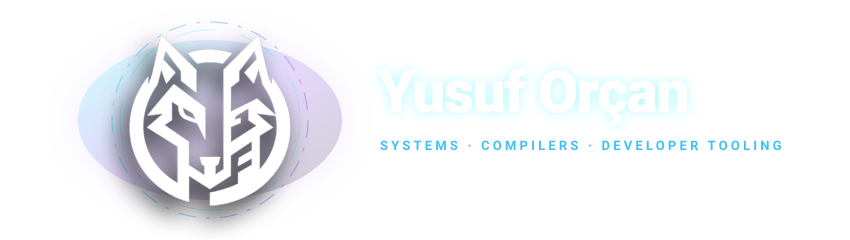
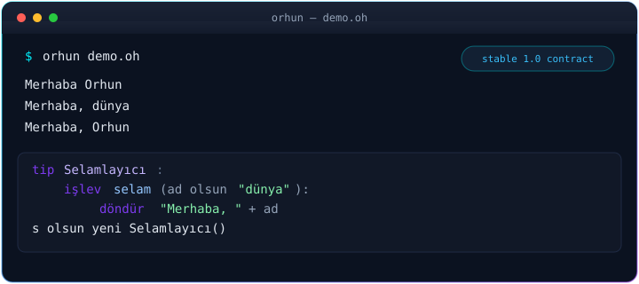
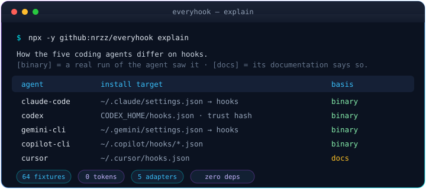

  
 <h1 align="center">Yusuf Orçan</h1> 
 <b>I design languages and the tools that keep them honest.</b> 
 
 Building <a href="https://github.com/orhunlang/orhun"><b>Orhun</b></a> — a Turkish-first programming language —  and a local-first toolkit that makes coding agents explain themselves. 

Two things, one story
1 · Orhun — a language with a contract
Turkish-first syntax and teaching diagnostics. C++17 bootstrap today, self-hosting tomorrow.

  

Contract	1.0 stable language · 1.1.0 current release
Pipeline	lexer → parser → interpreter → bytecode compiler → VM → stdlib
Identity	Turkish keywords (işlev, eğer, döndür) · English aliases · .oh source
Evidence	CI on Windows / Linux / macOS · release notes · cheatsheet

bash

Kopyala
curl -fsSL https://raw.githubusercontent.com/orhunlang/orhun/v1.1.0/install.sh | bash   # Linux / macOS
powershell

Kopyala
irm https://raw.githubusercontent.com/orhunlang/orhun/v1.1.0/install.ps1 | iex          # Windows
→ Repository · Docs · Project status

2 · everyhook — one hook, every coding agent
Claude Code · Codex CLI · Gemini CLI · Copilot CLI · Cursor.
Same contract, one adapter per agent, bench-tested against what they really send.

  

Evidence	
Adapters	5 agents, one contract
Fixtures	64 real captured documents
Tokens	0 for the tool · 0 for an installed hook, unless it returns a reason
Dependencies	None — Node 18+, node: modules only

bash

Kopyala
npx -y github:nrzz/everyhook explain
bash

Kopyala
git clone https://github.com/nrzz/everyhook
node everyhook/bin/everyhook.mjs install everyhook/examples/block-force-push.mjs --all
→ Repository · Examples

The rest of the ecosystem
Diagnostics that answer why, not just what.
Every claim is labeled verified / documented / not verified. Zero tokens unless the tool must speak.

Tool	Answers
claude-windows-doctor	Which shell the model gets on Windows — and the fix
claude-mcp-check	MCP servers Claude will load, cost, and why they fail
claude-settings-doctor	Merged settings with sources; dead rules removed
claude-permission-doctor	Why Claude asked — rule by rule
claude-cost-guard	Budgets from local transcripts; hard stop before the bill
codex-config-doctor	What Codex will actually do with your config

 
<b>Full toolkit</b>
  
Tool	What it does
agent-windows-doctor	Shell identity for every coding agent
claude-md-doctor	What CLAUDE.md costs per session
claude-hook-bench	Hooks against the exact JSON agents send
claude-session-replay	Session → HTML replay or Markdown
claude-session-tidy	Keep what matters past cleanup
claude-code-guardrails	Safety presets, cost zero until they stop something
claude-code-handover	Short sessions, durable decisions
claude-code-starter-kits	Lean .claude/ in one command
claude-code-team-sync	Share context, not logins
claude-chat-ferry	Move a chat across agents
claude-relocate	XDG paths and a safe config move
claude-automode-doctor	Decode auto-mode classifier verdicts

## Open source — the hard ones

Prefer a small number of deep fixes over a wall of easy PRs.

| Problem | Where | What landed |
| --- | --- | --- |
| Device-scoped atomics emitted with a by-value target | `CrossGL/crosstl` HIP codegen | In progress — pointer operand for `_system` forms |
| Locale-broken rule metadata on non-UTF-8 Windows | `IkarusAILabs/SafeAI` | Explicit `encoding="utf-8"` on every text I/O path + a GBK-default regression test |
| Unverified data reported as "available" | `aamirtechs/state-eligibility-matrix` | Placeholder rows stay `no` and cite `SRC_UNVERIFIED`; citation tests stay strict |
| Bounded delivery for cron / serverless | `pplytas/good-webhooks` | `run-once.ts` entrypoint: time budget, stop reason, lease-safe batches |
How I work
text

Kopyala
quiet focus      smallest change that removes a real blocker
clean contracts  clear beats clever; document the sharp edges
evidence first   verified · documented · not verified
local first      your machine, your tokens, your control
fail loudly      a quiet bug is a landmine

 <i>If a tool can’t say why it did something, it isn’t done.</i> 
 
 <a href="https://github.com/orhunlang/orhun">Orhun</a> · <a href="https://github.com/yoreva-01/everyhook">everyhook</a> · <a href="https://github.com/yoreva-01?tab=repositories">all repositories</a> 

